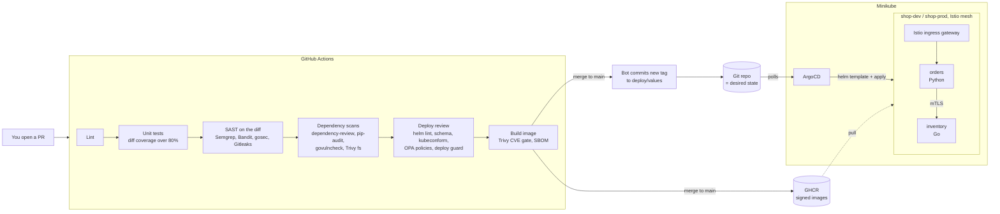

# k8s-platform-lab

A complete, small-scale production platform running on Minikube on your Mac. It has two
microservices, a gated CI pipeline, Helm packaging, GitOps delivery with ArgoCD, and an
Istio service mesh. Every file is commented, so the repo doubles as study material.



## What's inside

| You asked for | Where it lives |
|---|---|
| Lint, unit tests, coverage report, **over 80% on new lines** | `.github/workflows/ci.yaml` jobs `lint`, `test-python`, `test-go` (pytest-cov / `go test -cover` plus `diff-cover`) |
| Security scan of the change, **stop on any CVE** | `sast` (Semgrep diff-aware, Bandit, gosec, Gitleaks); `build-scan` (Trivy image scan, `exit-code 1`) |
| Dependency scans | `dependencies` (GitHub dependency-review, pip-audit, govulncheck, Trivy fs) |
| A reviewer that checks the **whole codebase** for deploy-time failures, nulls, lossy values | `deploy-review`: `values.schema.json`, kubeconform, OPA policies in `policy/`, and `tools/deploy_guard.py`. Optional AI reviewer in `ai-review.yaml` |
| Helm: package, upgrade, rollback, and manage Deployments, ConfigMaps, Secrets, Services | `charts/microservice/`, labs in `docs/04-helm.md` |
| ArgoCD deployments | `deploy/argocd/` (App of Apps + ApplicationSet; dev auto-syncs, prod is manual) |
| Istio service mesh | `bootstrap/istio-config.yaml`, `deploy/platform/istio-mesh.yaml`, chart `templates/istio.yaml` |

**Added on top, because a real platform needs it** (see `docs/01-architecture.md`, section "Why these extras"):
Sealed Secrets (Secrets can't go into git in plain text), GitOps image promotion with a
dev → prod PR, image signing (cosign) and SBOMs, secret scanning, OPA policy-as-code,
JSON-schema-validated Helm values, an env-var contract between code and platform, zero-trust
mTLS + AuthorizationPolicies, canary releases, fault injection and circuit breaking,
observability (Kiali, Prometheus, Grafana, Jaeger), HPA, PDB, quotas, probes, graceful shutdown,
non-root read-only containers, Dependabot, CODEOWNERS and branch protection.

## Quick start (Apple Silicon Mac)

Full walkthrough: [`docs/02-setup-macos.md`](docs/02-setup-macos.md).

```bash
# 0. Create a PUBLIC GitHub repo called k8s-platform-lab and push this folder to it
make init GH_USER=<your-github-username>   # puts your username into manifests
make tools                                  # brew installs: minikube, helm, istioctl, argocd, ...
make up                                     # minikube + Istio + Sealed Secrets + ArgoCD (~10 min)
make seal-secrets                           # encrypted API keys -> commit them
git add -A && git commit -m "bootstrap" && git push
#    wait for the "ci" workflow on main to go green (it builds images and bumps dev tags),
#    then in GitHub: Packages -> orders / inventory -> Package settings -> visibility: Public
make gitops                                 # ArgoCD takes over from here
make tunnel                                 # second terminal, keep running
make hosts
make smoke API_KEY=<dev key printed by seal-secrets>
make ui-argocd   # or ui-kiali, ui-grafana, ui-jaeger
```

## Repo layout

```
services/orders/        Python FastAPI service (calls inventory)
services/inventory/     Go stdlib service (stock ledger)
charts/microservice/    One reusable Helm chart for both services
deploy/values/          Per-service, per-environment values: THE file CI edits to deploy
deploy/platform/        Namespaces, quotas, mesh-wide mTLS, deny-all, ingress Gateway
deploy/argocd/          App of Apps, AppProject, ApplicationSet
deploy/local/           Values for the plain-Helm playground (no ArgoCD)
policy/                 OPA/Conftest rules + their unit tests
tools/                  deploy_guard.py, render.sh, Go coverage converter
bootstrap/              Istio and ArgoCD install config
scripts/                bootstrap, seal-secret, smoke, helm-lab
docs/                   The learning guide (start at 01)
```

## Learning path

1. [Architecture: how the pieces fit](docs/01-architecture.md)
2. [Setup on macOS](docs/02-setup-macos.md)
3. [CI/CD gates, one by one](docs/03-cicd.md)
4. [Helm: packaging, upgrade, rollback](docs/04-helm.md)
5. [ArgoCD and GitOps](docs/05-argocd.md)
6. [Istio service mesh](docs/06-istio.md)
7. [Hands-on labs: break it on purpose](docs/07-labs.md)
8. [Explain it to anyone + interview questions](docs/08-explain-it.md)
9. [Troubleshooting](docs/09-troubleshooting.md)

## Where to go next

Once all of this feels natural, these are the next things to build:

* **Argo Rollouts**: canary steps with automatic Prometheus analysis and auto-rollback, in place of hand-edited weights
* **Kyverno or Sigstore policy-controller**: make the cluster *refuse* unsigned images, not just CI
* **External Secrets Operator** with AWS Secrets Manager: the production version of Sealed Secrets
* **cert-manager**: real TLS on the ingress Gateway
* **SLOs and alerting**: Prometheus rules on error rate and latency, then error budgets
* **NetworkPolicies** (start Minikube with `--cni=calico`): L3/L4 defence beneath Istio's L7 policies
* **A real database** (StatefulSet + PVC, or RDS) and schema migrations as an ArgoCD PreSync hook
* **Multi-cluster**: the same ApplicationSet with a `clusters` generator, for example dev on Minikube and prod on EKS
