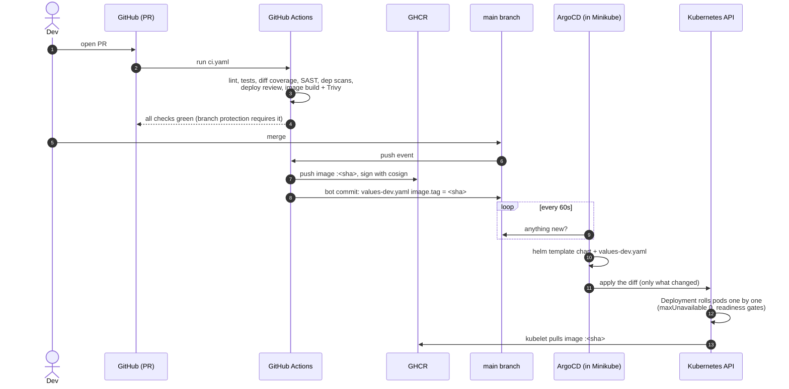
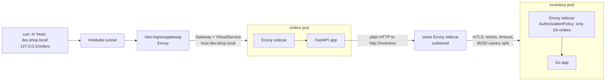
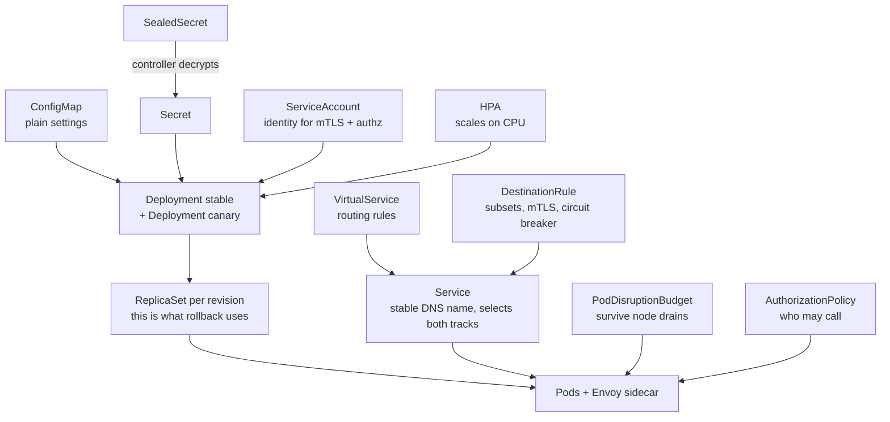

# 1. Architecture: how the pieces fit

## The one-sentence version

Developers change **git**. **GitHub Actions** proves the change is safe and turns it
into a signed image plus a one-line commit. **ArgoCD** notices the commit and uses **Helm**
to make **Kubernetes** match git. **Istio** then controls, secures and observes every
request between the services.

## Four planes

| Plane | Tools | Question it answers |
|---|---|---|
| **Build / CI** | GitHub Actions, pytest, go test, diff-cover, Semgrep, Trivy, OPA | Is this change safe to ship? |
| **Packaging** | Docker, Helm chart, values files | What exactly do we ship, and with what config per environment? |
| **Delivery / CD** | ArgoCD (GitOps), Sealed Secrets | How does the cluster get to the state that git describes, and stay there? |
| **Runtime** | Kubernetes, Istio, Prometheus, Kiali, Jaeger | How do requests flow, who may call whom, and what is happening right now? |

## Flow 1: a code change, from PR to running pod

Why the CI pipeline does **not** run `kubectl apply` or `helm upgrade` itself:

* **Pull, not push.** The cluster pulls its desired state. CI never holds cluster credentials,
  so a compromised pipeline can't touch the cluster directly. This matters even more when the
  cluster is private (your laptop, a VPC).
* **Git is the audit log.** "What is running in prod, who changed it, and when?" is answered by
  `git log deploy/values/*/values-prod.yaml`. Rollback = `git revert`.
* **Drift correction.** If someone runs `kubectl edit` by hand, ArgoCD (self-heal) puts it back.

## Flow 2: one request at runtime

What each hop adds:

1. **Ingress gateway**: the only entry point. The `Gateway` resource opens port 80 for the
   listed hostnames, and the `orders` VirtualService binds to it. `inventory` has no gateway
   binding, so it is unreachable from outside.
2. **orders' sidecar (outbound)**: the app calls `http://inventory`. Envoy intercepts the call,
   looks up the inventory VirtualService (timeout 3s, 2 retries, maybe a canary weight), picks a
   healthy endpoint (outlier detection ejects bad pods), and opens **mutual TLS** using the
   certificate for identity `spiffe://cluster.local/ns/shop-dev/sa/orders`.
3. **inventory's sidecar (inbound)**: it verifies the client certificate, and the
   AuthorizationPolicy allows only the `orders` identity. Anything else gets `403 RBAC: access denied`.
4. Both sidecars emit metrics (Prometheus), access logs and trace spans (Jaeger), so Kiali can
   draw the live graph without any code changes.

## The Kubernetes objects for one service, and why each exists

## Environments

| | dev (`shop-dev`) | prod (`shop-prod`) |
|---|---|---|
| Deploy trigger | automatic on every merge (CI bumps the tag) | PR made by `promote-to-prod` workflow, then a manual Sync in ArgoCD |
| ArgoCD sync | automated, prune, self-heal | manual |
| Replicas | fixed 2 | HPA 2-4 |
| Hostname | `dev.shop.local` | `shop.local` |
| Same chart? | yes: only the values differ. This is the point of Helm. | |

Both environments are namespaces in one Minikube cluster. In real life they would be separate
clusters, and the same ApplicationSet would target different `destination.server` values.

## The bootstrap problem

Something has to install the tool that installs everything else. `scripts/bootstrap.sh`
installs the **platform layer** imperatively (Istio, Sealed Secrets, ArgoCD). After
`make gitops`, ArgoCD manages everything else from git: namespaces, mesh policy, and the apps.
In bigger setups, ArgoCD then manages its own Helm release too ("ArgoCD manages ArgoCD"),
which is a good stretch exercise.

## Why these extras

| Extra | Problem it solves |
|---|---|
| **Sealed Secrets** | GitOps means everything is in git, but a Kubernetes Secret is only base64-encoded. A SealedSecret is encrypted with the cluster's public key, so only the in-cluster controller can decrypt it. |
| **values.schema.json** | Helm happily renders `replicaCount: null` or `port: "eighty"`. The schema makes `helm lint` and `helm template` (and so ArgoCD) refuse bad values. |
| **Deploy guard** | Catches cross-object bugs that schema checks can't see: a Service selector matching no pods, a missing Secret, an AuthorizationPolicy naming a typo'd service account, lossy YAML. |
| **Env-var contract** | The most common "works on my machine" deploy failure: code reads `FOO`, and the prod values don't set it. |
| **OPA / Conftest** | Organisation rules as code: no root, no privileged, only approved registries, STRICT mTLS. |
| **Image signing + SBOM** | Proves an image came from your pipeline, and records what is inside it for the next big CVE. |
| **Promotion by PR** | Prod changes get a review and an audit trail, and the exact image already tested in dev is the one that goes out. |
| **Canary, retries, circuit breaker, fault injection** | Release safely, and test how the system behaves when a dependency is slow or failing. |
| **Probes, PDB, HPA, graceful shutdown, quotas** | Zero-downtime rollouts, survival during node drains, scaling, and fair sharing of a small cluster. |
| **Observability** | You can't explain or debug a mesh you can't see. Kiali shows the graph, Jaeger the traces, Grafana the golden signals. |
