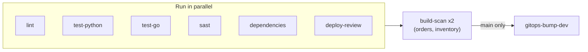

# 3. The CI/CD pipeline, gate by gate

File: `.github/workflows/ci.yaml`. Jobs 1 to 5 run **in parallel**, and `build-scan` waits for all
of them. That is the "fail fast, but tell me everything at once" layout.

## Gate 1: Lint (`lint`)

| Tool | Catches |
|---|---|
| `ruff check` | Python bugs and smells, plus a Bandit-style security subset (`S` rules) |
| `ruff format --check` | Formatting drift, so reviews are about logic and not whitespace |
| `mypy --strict` | Type errors. Strict mode enables **strict optional**: every `X \| None` must be handled before use, which is how null bugs get caught at build time |
| `golangci-lint` | `govet`, `staticcheck`, `gosec`, plus `nilnil` / `nilerr` (nil-value bugs), `errorlint`, `bodyclose` |
| `hadolint` | Dockerfile mistakes: running as root, `latest` base images, missing `--no-cache` |
| `actionlint` | Broken GitHub Actions syntax and shell bugs in `run:` blocks |

## Gate 2: Unit tests, coverage, and the >80% rule for new lines

Two different numbers, and both are enforced:

* **Total coverage ≥ 80%** for the whole service (`fail_under` in `pyproject.toml`; an `awk`
  check for Go). This stops slow decay.
* **Diff coverage > 80%**: of the lines **added or changed in this PR**, at least 80% must run
  during tests. This is the rule you asked for. It is the fairer gate, because a legacy codebase
  at 40% can still demand that new code is tested.

How diff coverage works:

1. pytest-cov writes `coverage.xml` (Cobertura format). For Go, `go test -coverprofile` writes
   blocks, and `tools/gocover_to_cobertura.py` converts them into Cobertura too.
2. `diff-cover` runs `git diff origin/main...HEAD`, keeps the added and changed lines, and looks
   each one up in the XML.
3. Covered / changed < 80% → exit 1. The job summary shows a Markdown table of the missed lines.

That's why the checkout uses `fetch-depth: 0`: diff-cover needs the base branch.

Try it: add an untested function to `services/inventory/internal/store/store.go`, open a PR,
and watch `test-go` fail with `Missing lines ...`.

## Gate 3: Security scan of the change (`sast`)

| Tool | Scope | Why |
|---|---|---|
| **Semgrep** with `--baseline-commit <PR base>` | **Only findings this PR introduces** | Exactly "scan the CR changes". Old findings don't block new work, and new ones can't sneak in. Rule packs: python, golang, dockerfile, kubernetes, github-actions, secrets |
| **Bandit** | Whole Python service | Python-specific security issues (`eval`, weak crypto, `subprocess` with shell) |
| **gosec** (in golangci-lint) | Whole Go service | Go-specific security issues |
| **Gitleaks** | Commits in this PR | API keys, tokens and passwords that were committed |

SAST (Static Application Security Testing) reads **your** code. CVEs are mostly in **other
people's** code (your dependencies and base image). Gates 4 and 6 cover those.

## Gate 4: Dependency scans (`dependencies`)

| Tool | What it checks |
|---|---|
| **dependency-review-action** | Diffs the dependency graph of the PR against main. Fails if a **newly added or upgraded** dependency has a known vulnerability (at any severity, `fail-on-severity: low`) or a denied license (GPL/AGPL). |
| **pip-audit** | Every pinned Python package against the PyPI advisory database |
| **govulncheck** | Go modules **and the Go standard library**. It is reachability-aware: it reports a CVE only if your code actually calls the vulnerable function. |
| **Trivy fs** | Every lockfile and manifest in the repo, plus leaked secrets |

## Gate 5: Deploy review of the whole codebase (`deploy-review`)

This is the "CR reviewer that runs across the entire codebase and flags anything that might
fail during deployment". It does not look at the diff. It renders **every service in every
environment** and checks the results as a whole, because deploy failures are usually
cross-file: a PR changes code in one place and breaks a values file somewhere else.

| Step | Tool | Typical catches |
|---|---|---|
| Render | `tools/render.sh`: `helm lint --strict` + `helm template` per service x env | Template errors, `required`/`fail` guards in the chart |
| Values schema | `charts/microservice/values.schema.json` (runs inside helm lint/template) | `replicaCount: null`, `image.tag: latest`, a number where a string is required, unknown keys from typos (`additionalProperties: false`) |
| K8s schema | `kubeconform -strict`, with CRD schemas for Istio and ArgoCD | Wrong field names, wrong types, misplaced keys. The same errors `kubectl apply` would give, but before merge |
| Policy | `conftest` + `policy/kubernetes.rego` | Privileged or root containers, `:latest`, unapproved registries, LoadBalancer services, PERMISSIVE mTLS, allow-all AuthorizationPolicies |
| Deploy guard | `tools/deploy_guard.py` | See below |

### What the deploy guard finds

**Nulls and false values**

* any `null` anywhere in a rendered manifest
* a values key with no value (`apiKey:`), which renders as null
* an env var that has a non-string value (`value: true`), which Kubernetes rejects
* in the app code: strict boolean parsing (`"False"` is not truthy), `require()` rejects
  `""`, `"null"` and `"<nil>"`, and a JSON `null` price is refused instead of becoming a free
  order. See `services/orders/app/config.py`, and the `*int` used for `quantity` in the Go handler.

**Lossy values**, meaning YAML that silently changes what you wrote:

| You wrote | YAML/Helm reads | Guard says |
|---|---|---|
| `enabled: yes` | `true` (YAML 1.1) | error: write true/false or quote it |
| `mode: 0755` | `493` (octal) | error: quote it |
| `version: 1.10` | `1.1` | error: quote it |
| `window: 1:30` | `90` (base 60) | error: quote it |
| `limit: 1000000` | can render as `1e+06` | warning, and the ConfigMap check fails on `1e+06` |
| `a: 1` ... `a: 2` | last one wins, silently | error: duplicate key |

**Broken references** (all of these apply fine and then fail at runtime):

* a Service selector that matches no pods (no endpoints: 503s)
* `envFrom` naming a ConfigMap or Secret that isn't rendered (`CreateContainerConfigError`)
* a `serviceAccountName` that doesn't exist
* a probe on a port name the container doesn't declare
* a PDB whose `minAvailable` is at least the replica count (node drains hang forever)
* VirtualService weights that don't add up to 100, unknown subsets, or traffic to a subset with no pods
* an AuthorizationPolicy that allows a service account which doesn't exist (a typo means 403s)
* missing probes, missing memory limits, `latest` tags, leftover placeholder tags

**The env-var contract** (`services/*/env-contract.yaml`): the guard greps the code for
`os.getenv`, `os.Getenv`, `require(...)` and the like. It fails if the code reads a variable that
isn't declared, or if any environment's rendered manifests don't provide a `required` one. This
is the "works in dev, CrashLoopBackOff in prod" class of bug, caught in the PR.

Run it locally with `make ci-local`. Its own unit tests are in `tools/tests/`, and each test plants one bug.

### The optional AI reviewer

`ai-review.yaml` runs the Claude Code GitHub Action with a prompt focused on deploy-time
risk. Add an `ANTHROPIC_API_KEY` repository secret to enable it. It only **comments**: hard
gates should be deterministic and reproducible, so it complements the guard and doesn't replace it.

## Gate 6: Build, CVE gate, SBOM, sign (`build-scan`)

1. Build the image on an **arm64 runner**, because your Minikube node is arm64.
2. **Trivy image scan**, with `exit-code: 1`, every severity, and `ignore-unfixed: true`.
   **Any CVE that has a fix stops the pipeline.** Unfixed CVEs are reported but don't block,
   because nobody can act on them. Delete `ignore-unfixed` if you want the literal "any CVE"
   rule, and expect to fight the base image. Accepted exceptions go in `.trivyignore` with an
   expiry date and a reason, through code review.
3. **SBOM** (SPDX) of the image, uploaded as an artifact.
4. On main only: push to GHCR and **cosign keyless signing**. GitHub's OIDC token proves
   "this image was built by this workflow in this repo", with no keys to manage.
   Verify a signature:
   `cosign verify ghcr.io/<you>/k8s-platform-lab/orders:<sha> --certificate-identity-regexp 'https://github.com/<you>/k8s-platform-lab/.*' --certificate-oidc-issuer https://token.actions.githubusercontent.com`

The image is scanned **before** it is pushed, so a vulnerable image never reaches the registry.

## Gate 7: GitOps handover (`gitops-bump-dev`)

CI's last act is a commit, not a deployment: `yq` sets `image.tag` in `values-dev.yaml`, and the
bot pushes. Pushes made with `GITHUB_TOKEN` don't trigger new workflow runs, so this can't loop.
ArgoCD sees the commit within 60 seconds and rolls out dev.

**Promotion to prod** is `promote-to-prod.yaml` (run it by hand). It copies the dev tags into
`values-prod.yaml` and opens a PR. The PR is reviewed and goes through the same gates. After the
merge, someone presses Sync. The image that ships is byte-for-byte the one tested in dev.

## Exercises: make each gate fail

| Gate | Change to make | Expected failure |
|---|---|---|
| lint | add `import os` unused in `app/main.py` | ruff F401 |
| mypy | `def f(x: str \| None) -> int: return len(x)` | `Argument 1 to "len" has incompatible type "str \| None"` |
| diff coverage | add an untested function | `Coverage is below 80%` |
| SAST | `subprocess.run(cmd, shell=True)` | Semgrep and Bandit |
| secrets | `AWS_SECRET="AKIA..."` in a file | Gitleaks |
| deps | add `pyyaml==5.3` to requirements.txt | pip-audit / dependency-review (CVE-2020-14343) |
| CVE | `FROM python:3.9-slim` with no upgrade | Trivy image scan |
| schema | `replicaCount: "2"` in values-dev.yaml | helm lint: `Invalid type. Expected: integer` |
| lossy | `FEATURE_DISCOUNTS: yes` (unquoted) | schema (must be string) and the guard (YAML 1.1 boolean) |
| contract | read `os.environ.get("NEW_FLAG")` in code | guard: `not in env-contract.yaml` |
| reference | `allowedServiceAccounts: ["order"]` | guard: `allows SA 'order', which doesn't exist` |
| policy | `securityContext: {privileged: true}` | schema `const: false` and conftest |
