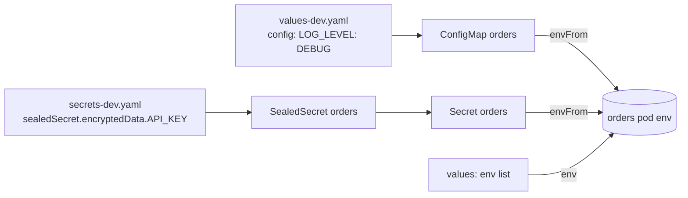

# 4. Helm: packaging, upgrade and rollback

## What Helm is, in three lines

* A **chart** is a folder of Kubernetes YAML templates plus default values.
* A **release** is one installed copy of a chart, with a name, in a namespace.
* Every `install`/`upgrade` creates a new **revision**, stored as a Secret in the namespace, so
  Helm can show history and roll back.

`template + values = manifests`. That's the whole trick. One chart serves both services and all
environments. Only the values files differ.

## Anatomy of `charts/microservice`

```
Chart.yaml              name, chart version (bump it when templates change), kubeVersion
values.yaml             every knob, with defaults and comments
values.schema.json      the type system for values: rejects nulls, wrong types, unknown keys
templates/
  _helpers.tpl          named templates: names, labels, and the shared pod template
  deployment.yaml       stable Deployment, plus a canary Deployment when istio.canary.enabled
  service.yaml          ClusterIP Service that selects both tracks
  configmap.yaml        from .Values.config. Fails rendering if a value isn't a string
  secret.yaml           a plain Secret (local) OR a SealedSecret (GitOps)
  serviceaccount.yaml   per-service identity (used by Istio mTLS and authz)
  hpa.yaml, pdb.yaml    scaling and disruption budget, with sanity checks
  istio.yaml            VirtualService, DestinationRule, AuthorizationPolicy
  tests/test-connection.yaml   `helm test` hook
  NOTES.txt             printed after install
```

Template techniques worth knowing (with where they are used):

| Technique | Where | Why |
|---|---|---|
| `include "x" . \| nindent 4` | everywhere | reuse a block at the right indentation |
| a shared `define` with `dict` arguments | `microservice.podTemplate` | the stable and canary Deployments share one pod spec |
| `required "msg" .Values.x` | canary imageTag, secret data | fail at render time with a clear message |
| `fail` | ConfigMap types, PDB vs replicas | encode rules the schema can't express |
| `checksum/config` annotation | pod template | **a ConfigMap change rolls the pods**. Without it, pods keep the old env vars forever |
| immutable selector labels | `_helpers.tpl` | `spec.selector` can't change after creation, so it never contains the version or chart version |
| `{{- if not .Values.autoscaling.enabled }} replicas:` | deployment.yaml | when the HPA owns the replica count, the Deployment must not set it |

## How the components get their config



* **ConfigMap**: non-secret settings, loaded as env vars via `envFrom`.
* **Secret**: same mechanism, but separate RBAC, and it can be encrypted at rest in etcd.
  base64 is **not** encryption.
* **SealedSecret**: what goes into git. The controller turns it into a Secret.

## Lab A: install, upgrade, rollback (plain Helm, no ArgoCD)

These labs use the `helm-lab` namespace. ArgoCD doesn't manage it, so its self-heal won't undo
your changes. Images are built straight into Minikube, so you don't need a registry.

```bash
make helm-lab TAG=v1                       # builds local/orders:v1 and local/inventory:v1, installs both
helm -n helm-lab list
helm -n helm-lab status orders
helm -n helm-lab get values orders         # the values you supplied
helm -n helm-lab get manifest orders | less    # what Helm actually applied
helm -n helm-lab test orders               # runs templates/tests/test-connection.yaml
```

Call it through the gateway (with `make tunnel` running):

```bash
curl -s -H "Host: lab.shop.local" -H "X-API-Key: local-lab-key" -H 'Content-Type: application/json' \
  -d '{"sku":"BOOK-1","quantity":1}' http://127.0.0.1/orders
```

### Upgrade (config change)

```bash
helm -n helm-lab upgrade orders charts/microservice -f deploy/local/orders.yaml \
  --set image.tag=v1 --set-string config.FEATURE_DISCOUNTS=true --set-string config.DISCOUNT_PERCENT=25 \
  --wait --timeout 3m
kubectl -n helm-lab rollout status deploy/orders      # pods restarted, because checksum/config changed
helm -n helm-lab history orders                       # revision 2
```

Try it with `--set config.DISCOUNT_PERCENT=25` first. `--set` passes a **number** (and `true`
a boolean), and the schema rejects it. That's the lossiness check at work. `--set-string`
keeps the value a string.

### Upgrade (new image)

Change something visible, e.g. the `version` field in `create_order`, then:

```bash
make helm-lab TAG=v2
kubectl -n helm-lab get rs -l app=orders       # old ReplicaSet scaled to 0 but kept: that's what rollback uses
```

### A bad release, and rollback

```bash
# Break the readiness probe on purpose:
helm -n helm-lab upgrade orders charts/microservice -f deploy/local/orders.yaml \
  --set image.tag=v2 --set probes.readiness.path=/nope --wait --timeout 90s
# -> times out. maxUnavailable 0 means the old pods kept serving the whole time.
helm -n helm-lab history orders                # the last revision is "failed"
helm -n helm-lab rollback orders 2 --wait      # back to revision 2
helm -n helm-lab history orders                # rollback creates a NEW revision: history only moves forward
```

Helm can roll back automatically when `--wait` fails: `--atomic` in Helm 3, renamed
`--rollback-on-failure` in Helm 4 (check `helm upgrade --help` for your version).

### Dry runs and diffs

```bash
helm -n helm-lab upgrade orders charts/microservice -f deploy/local/orders.yaml --set image.tag=v3 --dry-run=server
helm plugin install https://github.com/databus23/helm-diff   # Helm 4 may need --verify=false
helm -n helm-lab diff upgrade orders charts/microservice -f deploy/local/orders.yaml --set image.tag=v3
```

## Helm vs ArgoCD: who does what

With ArgoCD in the picture, **ArgoCD does not run `helm install`**. It runs `helm template` to
get plain manifests and applies them itself. So:

* `helm list` shows nothing for the ArgoCD-managed apps
* Helm hooks are translated to Argo hooks, and `helm test` hooks are ignored
* **Rollback in GitOps is a git revert** (or ArgoCD's History > Rollback, which pauses auto-sync).
  A `helm rollback` against an ArgoCD-managed app would be reverted by self-heal within a minute.

Helm is the **packaging format**. ArgoCD is the **delivery engine**.

## Packaging and publishing the chart (stretch)

```bash
helm package charts/microservice                 # microservice-0.1.0.tgz
helm push microservice-0.1.0.tgz oci://ghcr.io/<you>/charts
```

ArgoCD can then install it with `repoURL: ghcr.io/<you>/charts` and `chart: microservice`.
This is how a platform team shares one chart with many service teams.
