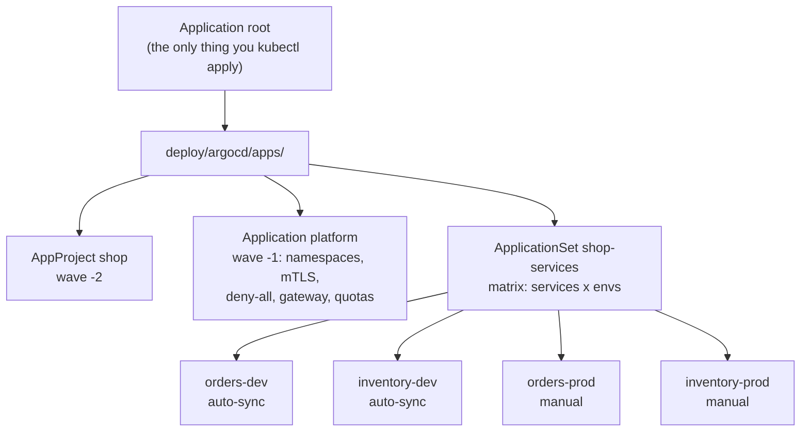

# 5. ArgoCD and GitOps

## GitOps in four principles

1. **Declarative**: the whole system is described as data (YAML), not as scripts.
2. **Versioned**: that description lives in git, which gives history, review and revert.
3. **Pulled**: an agent in the cluster pulls the desired state. CI never pushes into the cluster.
4. **Continuously reconciled**: the agent keeps comparing *live* with *desired* and fixes drift.

ArgoCD is that agent. Its loop runs every 60 seconds here (`timeout.reconciliation`), or
instantly with a git webhook:

```
desired = helm template(chart @ git HEAD, values-<env>.yaml)
live    = what the Kubernetes API says
diff    = desired - live      -> shown as OutOfSync
sync    = apply(diff)          -> automatic for dev, button press for prod
health  = are the Deployments rolled out, pods Ready, SealedSecrets unsealed?
```

## ArgoCD's components

| Component | Job |
|---|---|
| `argocd-server` | API + UI (`make ui-argocd`) |
| `argocd-repo-server` | clones git and runs `helm template`. It never talks to the cluster |
| `argocd-application-controller` | the reconcile loop: diffs, syncs, health checks |
| `argocd-applicationset-controller` | generates Applications from ApplicationSets |
| `redis` | cache |

## How this repo is wired: App of Apps + ApplicationSet



* **App of Apps**: one root Application points at a folder of Applications. Bootstrapping a new
  cluster is one `kubectl apply`.
* **ApplicationSet**: a generator (here a `matrix` of two `list`s) stamps out one Application per
  combination. A third service is one line in the list. A new environment is one more element.
* **AppProject**: guardrails. Apps in project `shop` may only use this repo, may only deploy to
  `shop-dev`, `shop-prod` and `istio-system`, and may only create Namespaces at cluster scope.
* **Sync waves** (`argocd.argoproj.io/sync-wave`): lower waves apply first, so the project and
  platform exist before the services that depend on them.
* **templatePatch**: adds `automated` sync only where `autoSync == "true"`. That's how dev and prod
  differ in sync policy while sharing one template.

## Sync options used here

| Option | Meaning |
|---|---|
| `automated.prune` | delete live objects that were removed from git |
| `automated.selfHeal` | revert manual changes (`kubectl edit`) back to git |
| `ServerSideApply=true` | let the API server do the merge: handles large objects and field ownership better |
| `PruneLast=true` | delete old objects only after the new ones are healthy |
| `retry` with backoff | ride out ordering races, e.g. a namespace that isn't there yet |
| `ignoreMissingValueFiles` | `secrets-<env>.yaml` is optional at render time |

## Lab B: watch GitOps work

```bash
argocd login localhost:8080 --username admin --insecure   # with make ui-argocd running
argocd app list
argocd app get orders-dev
argocd app diff orders-dev        # empty when in sync
```

1. **Deploy by commit**: change `LOG_LEVEL: "INFO"` in `deploy/values/orders/values-dev.yaml`,
   open a PR, merge it. In under a minute, `orders-dev` goes OutOfSync, syncs, and the pods roll
   (checksum annotation). `kubectl -n shop-dev get pods -w`
2. **Self-heal**: `kubectl -n shop-dev scale deploy/orders --replicas=5`. Watch ArgoCD put it back
   to 2. Now do the same in prod: prod has no self-heal, so the app just shows **OutOfSync** with
   the exact diff. This is drift detection without auto-correction.
3. **Prune**: set `pdb.enabled: false` in values-dev and merge. The PDB is no longer rendered,
   so ArgoCD deletes it from the cluster.
4. **Rollback**: `git revert <the commit>` and push. That's the GitOps rollback. The UI also
   has History and Rollback: it redeploys an older revision **and disables auto-sync**, because
   the cluster no longer matches git. Fix git, then re-enable auto-sync.
5. **Promotion**: run the `promote-to-prod` workflow, review and merge the PR, then
   `argocd app sync orders-prod inventory-prod` (or click Sync).
6. **A bad commit**: set `replicaCount: 0` in values-dev and open a PR. CI's schema check blocks it
   (`minimum: 1`). This is why the deploy-review gate exists: ArgoCD faithfully deploys whatever
   is in git, including your mistakes.

## Secrets in GitOps

The rule is that **nothing in git may be readable by someone who can read git**. Options:

| Approach | How | Used here? |
|---|---|---|
| **Sealed Secrets** | encrypt with the cluster's public key, commit the ciphertext | ✅ simple, no external dependency |
| External Secrets Operator | git holds a *reference*; the operator fetches from AWS Secrets Manager / Vault | the usual production choice on AWS |
| SOPS + KMS | encrypt files with a cloud KMS key; ArgoCD decrypts via a plugin | popular with Flux |

Back up the Sealed Secrets key, or lose every secret with the cluster:
`kubectl -n kube-system get secret -l sealedsecrets.bitnami.com/sealed-secrets-key -o yaml > sealed-key.yaml`
(and keep that file out of git).

## Things ArgoCD does not do (and what does)

* **Build images**: that's CI.
* **Progressive delivery** (pause at 10%, check metrics, then continue): that's **Argo Rollouts**,
  a sibling project. Here, the Istio weights are changed by hand. See `docs/07-labs.md`.
* **Update image tags by itself**: CI commits them here. Argo CD Image Updater can watch
  a registry and write back to git instead.
