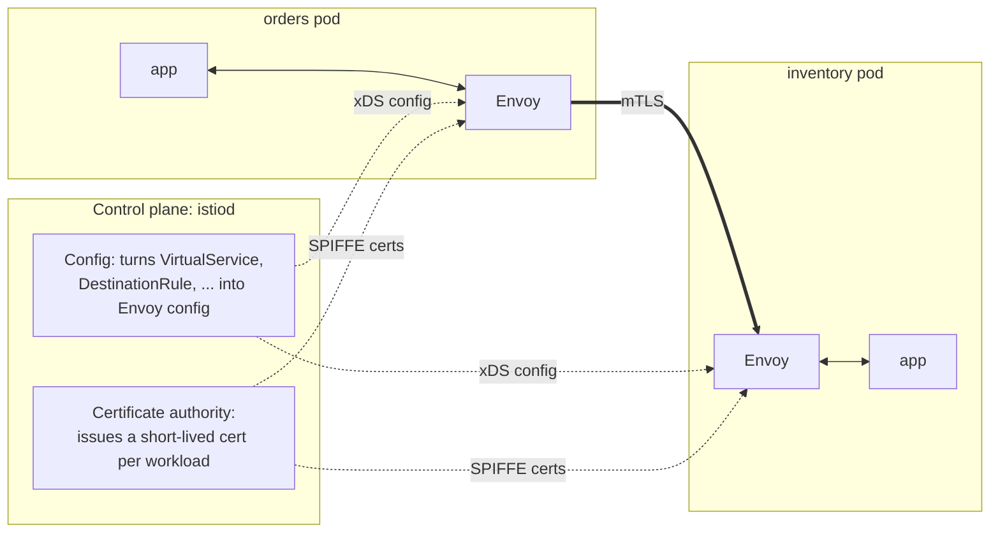

# 6. Istio service mesh

## The problem a mesh solves

With 2 services you can put retries, timeouts, TLS and metrics into the code. With 50 services
in 4 languages, you can't keep that consistent. A service mesh moves those concerns **out of the
code and into the network layer**, where they are configured centrally as YAML.

## How it works: sidecars



1. The namespace label `istio-injection=enabled` makes a **mutating admission webhook** add an
   `istio-proxy` container (Envoy) to every new pod, plus an init step that installs iptables rules.
2. The iptables rules send **all** inbound and outbound pod traffic through Envoy. The app doesn't know.
3. **istiod** watches Kubernetes Services and Istio resources and pushes config to every Envoy
   over xDS. It also acts as a CA: each pod gets a certificate for its ServiceAccount identity,
   `spiffe://cluster.local/ns/<ns>/sa/<sa>`, rotated automatically.

See it for yourself:

```bash
kubectl -n shop-dev get pod -l app=orders -o jsonpath='{.items[0].spec.containers[*].name}'   # app istio-proxy
istioctl proxy-status                                   # is every Envoy in sync with istiod?
istioctl proxy-config routes deploy/orders -n shop-dev  # the routes Envoy actually has
istioctl x describe pod <orders-pod> -n shop-dev        # which Istio resources apply to this pod
istioctl analyze -A                                     # lint the live mesh config
```

**Ambient mode** (no sidecars: a per-node `ztunnel` for mTLS, plus optional waypoint proxies for
L7) is the newer alternative and worth knowing about. This lab uses sidecars because they are
still the most common setup in production and the easiest to see.

## The Istio resources this repo uses

| Resource | Answers | In this repo |
|---|---|---|
| **Gateway** | Which ports and hostnames does the edge proxy accept? | `shop-gateway`: port 80, `dev.shop.local`, `shop.local`, `lab.shop.local` |
| **VirtualService** | How is a request to host X routed? | per service: timeout 3s, 2 retries on 5xx/connect-failure, canary weights, fault injection |
| **DestinationRule** | What are the destination's subsets, and how do we connect to it? | subsets `stable` and `canary` (by the `version` label), ISTIO_MUTUAL TLS, connection pool, outlier detection |
| **PeerAuthentication** | Must traffic to a workload be mTLS? | mesh-wide `STRICT` |
| **AuthorizationPolicy** | Who may call this workload? | `deny-all` per namespace, then: inventory ← orders only; orders ← ingress gateway |
| **Telemetry** | What to trace, log and measure? | 100% trace sampling to Jaeger |

## Security: zero trust in three layers

1. **Encryption + identity**: STRICT mTLS. Check it in Kiali (padlock icons), or run
   `istioctl x describe pod <pod> -n shop-dev`.
2. **Default deny**: `AuthorizationPolicy deny-all` with an empty spec matches nothing, so it
   allows nothing.
3. **Least privilege**: each service's chart adds an ALLOW rule for exactly the identities that
   need it.

Prove it:

```bash
# A pod without a sidecar can't even connect (plaintext is refused by STRICT mTLS):
kubectl -n default run tmp --rm -it --image=curlimages/curl:8.11.1 --restart=Never -- \
  curl -sv http://inventory.shop-dev/stock/BOOK-1
# A pod in the mesh but with the wrong identity gets 403:
kubectl -n shop-dev run tmp --rm -it --image=curlimages/curl:8.11.1 --restart=Never -- \
  curl -s http://inventory/stock/BOOK-1           # -> RBAC: access denied
# (Press Ctrl-C afterwards: the sidecar keeps this throwaway pod alive after curl exits.)
```

## Traffic management

**Timeouts and retries** live in the VirtualService. The Python client uses plain `httpx`.
Envoy retries a 503 from inventory twice, with a 1s per-try timeout, inside an overall 3s budget.
Watch out for **retry storms**: retries multiply load on a service that is already struggling.
That's why there is a cap and an overall timeout.

**Circuit breaking** is `outlierDetection` in the DestinationRule. After 5 consecutive 5xx errors,
a pod is ejected from the load-balancing pool for 30s, at most 50% of the pool at a time.

**Canary release** (see Lab D in `07-labs.md`):

```yaml
# deploy/values/inventory/values-dev.yaml
istio:
  canary:
    enabled: true
    imageTag: "<new sha>"
    weight: 10        # 10% of requests go to the canary pods, 90% to stable
```

This is **weight-based, not replica-based**: one canary pod can take exactly 10% of the traffic.
Without Istio, a Kubernetes Service splits by pod count. Every response carries
`X-Inventory-Version`, so you can watch the split.

**Fault injection** tests resilience without breaking anything for real:

```yaml
istio:
  faultInjection:
    enabled: true
    delay: {percentage: 50, fixedDelay: 2s}     # half of the calls take 2s longer
    abort: {percentage: 10, httpStatus: 503}    # 10% fail immediately
```

Then ask yourself: does orders return a clean 502? Do the retries hide the aborts? (They don't:
see Lab E.) What does the p99 latency look like in Grafana?

## Observability you get for free

```bash
make ui-kiali     # live topology graph, mTLS padlocks, request rates, error rates
make ui-grafana   # Istio Service / Workload dashboards: the golden signals
make ui-jaeger    # traces: ingress -> orders -> inventory, with timing per hop
kubectl -n shop-dev logs deploy/orders -c istio-proxy --tail=20   # Envoy access log
```

The four **golden signals** (latency, traffic, errors, saturation) come from the sidecars, so every
service has them, whatever its language. For traces that connect across hops, the app must
**forward the trace headers** (`traceparent`, `x-b3-*`, `x-request-id`) from the incoming request
to the outgoing one. Envoy can't do that part for you. That's a good exercise in `orders`.

## Egress

`outboundTrafficPolicy: REGISTRY_ONLY` means pods can only call hosts the mesh knows about. Calling
`https://example.com` from orders fails until you add a `ServiceEntry` for it. That's the start of
egress control.
